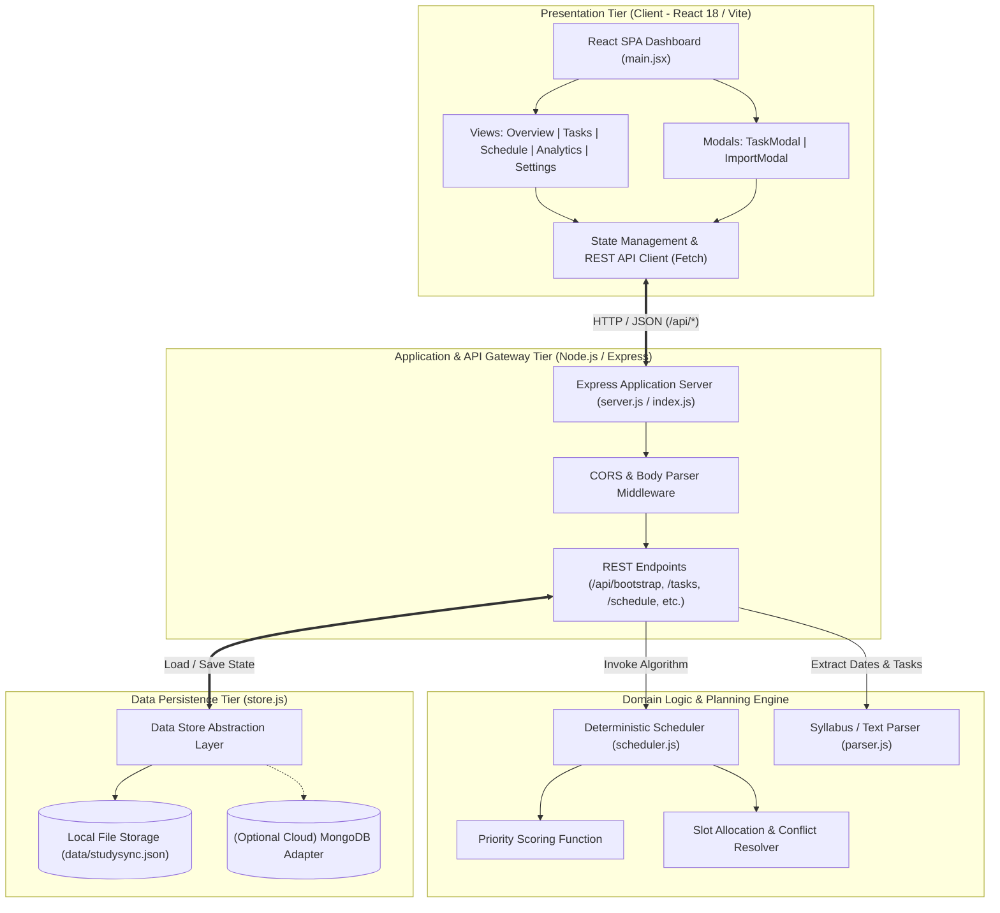
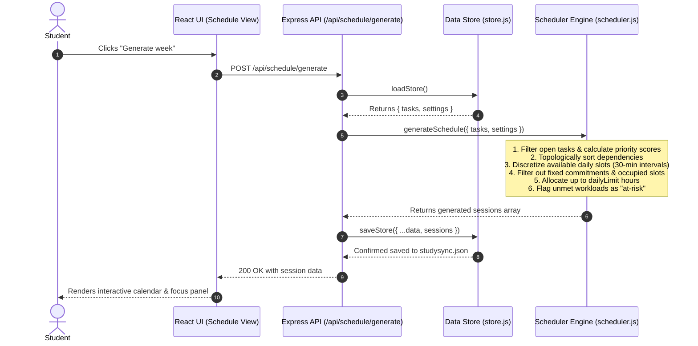
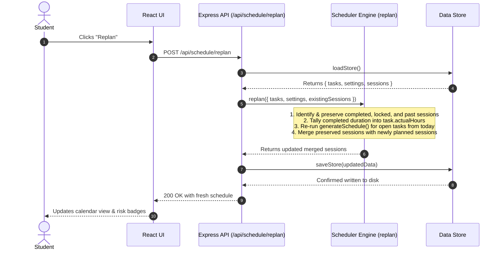
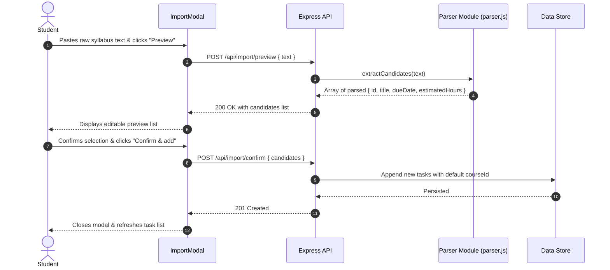

# High-Level Design (HLD)

## Project Title: StudySync AI (Intelligent Academic Workload & Schedule Planner)
- **Document Version**: 1.0.0
- **Status**: Approved & Architecture Baseline
- **Scope**: Multi-tier architecture, system components, sequence flows, data flows, technology stack, and interface contracts.

---

## 1. System Architecture Overview

StudySync AI follows a decoupled, three-tier modular architecture designed for local-first execution with seamless enterprise cloud extensibility. The system separates user presentation, RESTful business orchestration, deterministic core domain logic, and persistent storage.

---

## 2. Component Decomposition & Responsibilities

### 2.1 Presentation Tier (Frontend Client)
- **Framework**: React 18 paired with Vite for high-performance builds and instant HMR.
- **Styling**: Modern, semantic CSS with custom properties (`styles.css`), clean emerald/mint brand palette, responsive grid layouts, and cards.
- **Icons**: Lucide React iconography for intuitive navigation and status indicators.
- **Key Modules**:
  - `App`: Top-level orchestrator handling navigation state (`overview`, `tasks`, `schedule`, `analytics`, `settings`), global modals, and polling/refresh logic.
  - `Overview View`: Displays aggregate KPI cards (Completion %, Planned Hours, Actual Effort, Deadline Risks), "Today's Focus" chronological session stream, upcoming deadlines, and explainable planning insights.
  - `Tasks View`: Full task inventory with status toggles (`todo`, `in-progress`, `done`), priority indicators, course tags, and deletion controls.
  - `Schedule View`: Weekly calendar layout grouping planned sessions by date, displaying start time, duration, course metadata, explainable scheduling reasons, and completion check-offs. Also hosts "Replan" and "Generate Week" triggers.
  - `Analytics View`: Progress bars, Planned vs. Actual effort comparison charts, and an active Deadline Health risk audit.
  - `TaskModal` & `ImportModal`: Interactive dialogs for creating single tasks or batch-parsing assignments from syllabus text.

### 2.2 Application / API Tier (Express Gateway)
- **Framework**: Express 4 running on Node.js 18+.
- **Middleware**: `cors` for cross-origin access during local development; `express.json({ limit: '2mb' })` for syllabus text payload ingestion.
- **Responsibilities**:
  - Validates client request payloads (e.g., verifying `title`, `courseId`, `dueDate`, `estimatedHours`).
  - Orchestrates calls between the persistence layer and domain engines.
  - Computes dynamic analytical metrics on demand via `/api/analytics`.

### 2.3 Domain Engine Tier (Planning & Parsing Logic)
- **Scheduler Engine (`server/scheduler.js`)**:
  - `priorityScore(task, today)`: Computes multi-factor urgency, importance, complexity, and remaining effort scores.
  - `availableSlots(date, settings)`: Discretizes day availability windows into 30-minute intervals.
  - `generateSchedule({ tasks, settings, from, days })`: Resolves dependencies via topological ordering, iterates across available days, places non-overlapping study blocks up to the daily limit, and flags residual effort as `at-risk`.
  - `replan({ tasks, settings, existingSessions, today })`: Preserves completed, locked, and historical sessions, recalculates accumulated actual hours, and invokes the scheduler on open tasks.
- **Text Parser (`server/parser.js`)**:
  - Regex-based tokenization extracting ISO (`YYYY-MM-DD`) and slash (`MM/DD/YYYY`) date formats.
  - Candidate assignment normalization providing fallback titles and default estimates.

### 2.4 Data Persistence Tier (`server/store.js`)
- Provides an asynchronous Data Access Object (DAO) interface: `loadStore()` and `saveStore(data)`.
- Implements atomic directory and file creation with seed data provisioning on first boot.
- Generates cryptographically secure collision-resistant identifiers via Node's `crypto.randomUUID`.

---

## 3. End-to-End Sequence & Data Flow Diagrams

### 3.1 Weekly Schedule Generation Flow
The following sequence diagram illustrates how a user triggers weekly schedule generation and how constraints are applied:

### 3.2 Dynamic Replanning Flow
When assignments run over time or a student misses a planned block, the replanning workflow retains historical integrity:

### 3.3 Text & Syllabus Import Flow

---

## 4. Technology Stack & Technical Rationale

| Layer | Technology | Version | Justification |
| :--- | :--- | :--- | :--- |
| **Frontend Framework** | React | `^18.3.1` | Component-driven architecture, declarative state handling, and virtual DOM for rapid UI reconciliation. |
| **Build Tooling** | Vite | `^6.0.5` | Instant server start, blazing-fast Hot Module Replacement (HMR), and optimized production tree-shaking. |
| **Icons** | Lucide React | `^0.468.0` | Clean, modern vector icons for academic task visualization with zero runtime styling dependencies. |
| **Backend Runtime** | Node.js | `>=18` | Native ES Module support, built-in test runner (`node:test`), and native crypto support. |
| **Web Framework** | Express | `^4.21.2` | Minimalist, unopinionated routing layer with proven stability and low memory footprint. |
| **Cross-Origin** | CORS | `^2.8.5` | Standard middleware enabling secure communication between Vite dev server (port 5173) and API (port 4000). |
| **Persistence** | Local JSON Store | Native | Zero-dependency, file-based persistence for instant setup, zero cloud credentials, and user data privacy. |
| **Future DB Option** | MongoDB / Mongoose | — | Pre-architected interface in `server/store.js` allows drop-in replacement with `MONGODB_URI`. |

---

## 5. API Surface & Interface Contracts

The API operates under the `/api` namespace, communicating via standard JSON representations.

| Method | Endpoint | Request Body Summary | Response Summary | Status Codes |
| :--- | :--- | :--- | :--- | :--- |
| `GET` | `/api/bootstrap` | *None* | Complete state object: `{ courses, tasks, sessions, settings }` | `200` |
| `POST` | `/api/tasks` | `{ title, courseId, dueDate, estimatedHours, importance?, complexity? }` | Newly created task entity with generated UUID | `201`, `400` |
| `PATCH` | `/api/tasks/:id` | Partial task object (e.g. `{ status: "done" }`) | Updated task entity | `200`, `404` |
| `DELETE` | `/api/tasks/:id` | *None* | *Empty body* (cascades deletion of associated sessions) | `204` |
| `POST` | `/api/schedule/generate`| *None* (reads tasks & settings from store) | Array of newly generated study `Session` objects | `200` |
| `POST` | `/api/schedule/replan` | *None* (reads tasks, settings, & existing sessions) | Array of merged preserved and recalculated `Session` objects | `200` |
| `PATCH` | `/api/sessions/:id` | Partial session object (e.g. `{ status: "completed" }`) | Updated session entity | `200`, `404` |
| `POST` | `/api/import/preview` | `{ text: string }` | `{ candidates: Array<CandidateTask>, source: string }` | `200`, `400` |
| `POST` | `/api/import/confirm` | `{ candidates: Array<CandidateTask> }` | Array of finalized `Task` objects persisted | `201` |
| `PUT` | `/api/settings` | `{ dailyLimit?: number, availability?: object, fixedCommitments?: array }` | Updated settings object | `200` |
| `GET` | `/api/analytics` | *None* | Analytical metrics: completion rate, total/planned/actual hours, overloaded days, risk sessions | `200` |

---

## 6. Non-Functional Architecture & Security

### 6.1 Reliability & Data Integrity
- Atomic read-modify-write cycles in `server/store.js` protect data integrity.
- Directory validation ensures the `data/` directory exists before writing `studysync.json`.
- Automatic fallback initializes default seed courses, tasks, and settings if no data file is detected.

### 6.2 Security & Data Privacy
- **Zero Third-Party Data Transmission**: The parsing engine is completely local and deterministic; no student assignment notes or syllabus text are transmitted to external AI APIs.
- **Input Validation**: Required fields are strictly validated before state mutations.
- **Payload Limits**: Ingestion payloads are capped at 2MB via `express.json({ limit: '2mb' })` to mitigate payload denial-of-service risks.

### 6.3 Scalability & Deployment Path
- **Stateless Backend**: The Express application logic maintains no in-memory session state; all state lives in the persistence layer, making it fully ready for containerization (`Docker`).
- **Production Readiness**:
  - The frontend builds to static HTML/JS/CSS assets via `npm run build` into `dist/`.
  - The static output can be served directly by Express or hosted via a CDN (e.g., Cloudflare Pages, Vercel) while the backend deploys on platforms such as Render or Railway.
