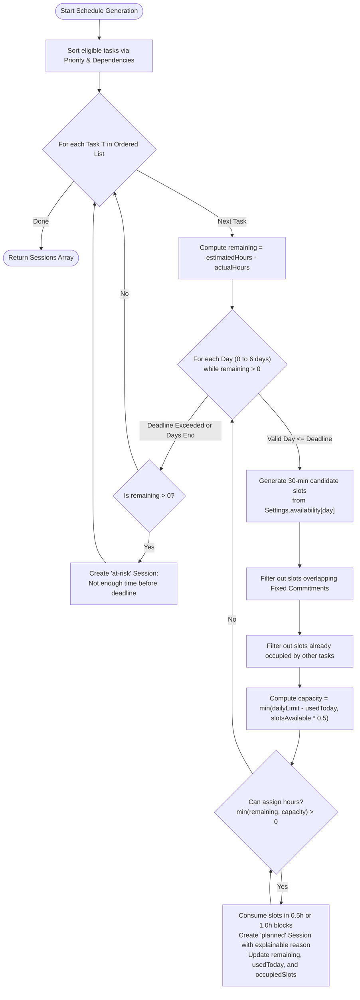

# Low-Level Design (LLD)

## Project Title: StudySync AI (Intelligent Academic Workload & Schedule Planner)
- **Document Version**: 1.0.0
- **Status**: Approved & Implementation Ready
- **Scope**: Data models, schemas, algorithmic formulas, module logic, API request/response payloads, frontend component hierarchy, and test suite specifications.

---

## 1. Data Models & Entity Schemas

All entities are represented in JSON and validated at the API boundary.

### 1.1 Course Entity
Represents an academic course subject.
```typescript
interface Course {
  id: string;        // Unique identifier (e.g., "course-cs")
  name: string;      // Full course title (e.g., "Data Structures")
  code: string;      // Course code (e.g., "CS 204")
  color: string;     // Hex color code for UI badges (e.g., "#00796B")
}
```

### 1.2 Task Entity
Represents an assignment, project, or homework milestone.
```typescript
interface Task {
  id: string;                 // Generated via id('task') -> "task-xxxxxxxx"
  title: string;              // Descriptive title of the assignment
  courseId: string;           // Reference to Course.id
  dueDate: string;            // ISO 8601 date string ("YYYY-MM-DD")
  estimatedHours: number;     // Total estimated workload in hours (>= 0.5)
  actualHours: number;        // Accumulated hours logged so far (default 0)
  importance: number;         // Priority multiplier from 1 (lowest) to 5 (highest)
  complexity: number;         // Difficulty multiplier from 1 (lowest) to 5 (highest)
  status: 'todo' | 'in-progress' | 'done';
  dependencies: string[];     // Array of Task IDs that must precede this task
  notes?: string;             // Optional user notes or syllabus context
}
```

### 1.3 Session Entity
Represents a scheduled block of study time allocated to a specific task.
```typescript
interface Session {
  id: string;                 // Format: "session-{taskId}-{date}-{start}" or "risk-{taskId}"
  taskId: string;             // Reference to Task.id
  date: string;               // ISO date string ("YYYY-MM-DD")
  start: number | null;       // Fractional hour (e.g., 18.5 = 18:30); null for at-risk
  duration: number;           // Duration in hours (e.g., 0.5 or 1.0)
  status: 'planned' | 'completed' | 'locked' | 'at-risk';
  reason: string;             // Transparent, explainable rationale for this session
}
```

### 1.4 Settings & Availability Entities
User-defined preferences governing scheduling constraints.
```typescript
interface FixedCommitment {
  day: 'Sun' | 'Mon' | 'Tue' | 'Wed' | 'Thu' | 'Fri' | 'Sat';
  start: number;              // Start hour in 24h format (e.g., 19 for 7:00 PM)
  end: number;                // End hour in 24h format (e.g., 20 for 8:00 PM)
  label: string;              // Human-readable label (e.g., "Gym", "Lecture")
}

interface Settings {
  dailyLimit: number;         // Maximum study hours allowed per calendar day (e.g., 3)
  availability: {             // Daily available study windows [startHour, endHour]
    Mon?: [number, number];
    Tue?: [number, number];
    Wed?: [number, number];
    Thu?: [number, number];
    Fri?: [number, number];
    Sat?: [number, number];
    Sun?: [number, number];
  };
  fixedCommitments: FixedCommitment[];
}
```

### 1.5 Root Store Entity (`data/studysync.json`)
```typescript
interface StoreSchema {
  settings: Settings;
  courses: Course[];
  tasks: Task[];
  sessions: Session[];
}
```

---

## 2. Algorithmic Specifications

### 2.1 Priority Scoring Algorithm (`priorityScore`)

The scheduler ranks eligible tasks using a multi-factor scoring formula that balances urgency, importance, complexity, and remaining effort.

#### Mathematical Formula:
$$\text{daysUntilDue} = \max\left(0, \left\lceil \frac{\text{dueDate} - \text{today}}{86,400,000} \right\rceil\right)$$

$$\text{urgency} = \max(0, 12 - \text{daysUntilDue})$$

$$\text{remaining} = \max(0, \text{estimatedHours} - \text{actualHours})$$

$$\text{Score} = (\text{urgency} \times 4) + (\text{importance} \times 3) + (\text{complexity} \times 2) + \text{remaining}$$

#### Weighting Rationale:
- **Urgency ($\times 4$)**: High weight ensures upcoming deadlines within 12 days immediately bubble to the top.
- **Importance ($\times 3$)**: Prevents low-value busywork from displacing core milestone projects.
- **Complexity ($\times 2$)**: Harder assignments are scheduled earlier to avoid cognitive exhaustion near deadlines.
- **Remaining ($\times 1$)**: Acts as a tie-breaker prioritizing heavier workloads before smaller quick tasks.

---

### 2.2 Topological Dependency Resolution

Prerequisite tasks must be scheduled before dependent tasks, regardless of their raw priority scores.

#### Logic (`addWithDependencies`):
1. Create an ordered output list $O = []$ and a visited set $V = \emptyset$.
2. Sort tasks by descending `priorityScore`.
3. For each task $T$ in the sorted list:
   - If $T \in V$, skip to avoid redundant evaluation.
   - Mark $T$ in $V$.
   - Iterate over each prerequisite ID $D \in T.\text{dependencies}$:
     - If $D.\text{status} \neq \text{'done'}$, recursively invoke `addWithDependencies(D)`.
   - Append $T$ to $O$ if not already present.
4. Result: A topologically valid array of tasks where all incomplete prerequisites strictly precede their dependents.

---

### 2.3 Constraint-Satisfaction Slot Allocation

The slot allocator schedules tasks into 30-minute discrete slots across the planning horizon (default 7 days).



#### Collision Detection Rules:
A candidate slot starting at $S$ with duration $0.5\text{h}$ is invalid if:
$$\exists C \in \text{fixedCommitments} \quad \text{such that} \quad C.\text{day} = \text{currentDay} \land S < C.\text{end} \land (S + 0.5) > C.\text{start}$$
or if $S \in \text{occupiedSlots}[\text{currentDate}]$.

---

### 2.4 Dynamic Replanning Algorithm (`replan`)

When the user initiates a replan:
1. **Preserve Immutables**: Extract sessions meeting any of the following criteria:
   - $\text{session}.\text{status} = \text{'completed'}$
   - $\text{session}.\text{status} = \text{'locked'}$
   - $\text{session}.\text{date} < \text{iso}(\text{today})$
2. **Recompute Actual Work**:
   For each task $T$, recalculate effective logged effort:
   $$T.\text{actualHours} = T.\text{actualHours} + \sum \left\{ S.\text{duration} \mid S.\text{taskId} = T.\text{id} \land S.\text{status} = \text{'completed'} \right\}$$
3. **Reschedule Open Work**:
   Call `generateSchedule({ tasks: openTasks, settings, from: today })`.
4. **Merge**: Return $[ \dots\text{preserved}, \dots\text{newlyGenerated} ]$.

---

### 2.5 Deterministic Text & Syllabus Parser (`extractCandidates`)

Extracts assignments from unstructured raw text lines without external API calls:
1. Split text into lines by newline `\r?\n`, trim whitespace, and discard blank lines.
2. Evaluate each line against date regex:
   ```javascript
   const datePattern = /(\d{4}-\d{2}-\d{2}|\d{1,2}[/-]\d{1,2}[/-]\d{2,4})/
   ```
3. If matched:
   - Normalize date to ISO `YYYY-MM-DD`.
   - Strip the date substring and trailing delimiters (`:`, `-`, `–`) from the line to produce the candidate title.
   - If title is empty, assign fallback: `"Imported assignment " + (index + 1)`.
   - Default `estimatedHours = 2`, `importance = 3`, `complexity = 3`.
4. Return an array of valid candidate objects.

---

## 3. API Endpoint Detailed Specifications

### 3.1 `GET /api/bootstrap`
- **Description**: Initial bulk data fetch.
- **Response `200 OK`**:
```json
{
  "settings": {
    "dailyLimit": 3,
    "availability": { "Mon": [18, 21], "Tue": [18, 21], "Wed": [16, 21], "Thu": [18, 21], "Fri": [15, 19], "Sat": [10, 16], "Sun": [12, 17] },
    "fixedCommitments": [{ "day": "Mon", "start": 19, "end": 20, "label": "Gym" }]
  },
  "courses": [
    { "id": "course-cs", "name": "Data Structures", "code": "CS 204", "color": "#00796B" },
    { "id": "course-design", "name": "Interaction Design", "code": "DES 118", "color": "#D97706" }
  ],
  "tasks": [
    { "id": "task-graph", "title": "Graph algorithms problem set", "courseId": "course-cs", "dueDate": "2026-10-19", "estimatedHours": 4, "actualHours": 1, "importance": 5, "complexity": 4, "status": "in-progress", "dependencies": [], "notes": "Shortest paths" }
  ],
  "sessions": []
}
```

### 3.2 `POST /api/tasks`
- **Description**: Creates a new task.
- **Request Body**:
```json
{
  "title": "Database Lab 3",
  "courseId": "course-cs",
  "dueDate": "2026-10-25",
  "estimatedHours": 3,
  "importance": 4,
  "complexity": 3
}
```
- **Validation**: Checks presence of `title`, `courseId`, `dueDate`, `estimatedHours`. Returns `400 Bad Request` if missing.
- **Response `201 Created`**: Returns populated `Task` with generated `id`, `status: "todo"`, and `actualHours: 0`.

### 3.3 `DELETE /api/tasks/:id`
- **Description**: Deletes task and cascades deletion to all associated sessions.
- **Response `204 No Content`**.

### 3.4 `POST /api/schedule/generate`
- **Description**: Triggers weekly schedule generation.
- **Response `200 OK`**: Returns array of `Session` objects:
```json
[
  {
    "id": "session-task-graph-2026-10-15-18",
    "taskId": "task-graph",
    "date": "2026-10-15",
    "start": 18,
    "duration": 1,
    "status": "planned",
    "reason": "Prioritized for 2026-10-19: 5/5 importance and 3h remaining."
  }
]
```

### 3.5 `GET /api/analytics`
- **Description**: Returns computed progress and risk metrics.
- **Response `200 OK`**:
```json
{
  "totalHours": 11,
  "completedTasks": 0,
  "taskCount": 3,
  "plannedHours": 8,
  "actualHours": 1,
  "completion": 0,
  "overloadedDays": [],
  "risks": []
}
```

---

## 4. Frontend Component Hierarchy & State Flow

```
<App>
  ├── <aside className="sidebar">
  │     ├── Brand & Navigation Links (Overview, Tasks, Schedule, Analytics)
  │     └── Bottom Actions (Import syllabus, Preferences, Profile)
  └── <main className="main">
        ├── <header className="topbar"> (Date indicator, dynamic title, actions)
        ├── {error && <ErrorBanner />}
        │
        ├── <Overview> (view === 'overview')
        │     ├── <section className="stat-grid"> -> <Stat /> * 4
        │     ├── <div className="focus-panel"> -> <SessionRow /> * N
        │     ├── <div className="panel"> (Upcoming deadlines)
        │     └── <div className="plan-banner"> (Planning insight explanation)
        │
        ├── <Tasks> (view === 'tasks')
        │     └── <div className="task-table"> (Task rows, status selector, delete button)
        │
        ├── <Schedule> (view === 'schedule')
        │     └── <div className="calendar-list">
        │           └── <div className="day-group"> -> <ScheduleCard /> * N
        │
        ├── <Analytics> (view === 'analytics')
        │     ├── <div className="metric-large"> (Completion progress bar)
        │     ├── <div className="chart-panel"> (Planned vs. Actual comparison)
        │     └── <div className="risk-panel"> (Deadline health alerts)
        │
        ├── <Settings> (view === 'settings')
        │     └── Form inputs for daily study limit & availability
        │
        ├── <TaskModal> (modal === 'task')
        └── <ImportModal> (modal === 'import')
```

---

## 5. Testing & Verification Specifications

The test suite is executed using Node's native test runner (`node --test tests/*.test.js`).

### Test Suite: `tests/scheduler.test.js`

| Test Case | Scenario / Assertion | Expected Result |
| :--- | :--- | :--- |
| **TC-01: Dependency Ordering** | Task `A` depends on Task `B`. Both due on same day. | Session for `B` is scheduled before session for `A` (`sessions[0].taskId === 'base'`). |
| **TC-02: Fixed Commitment Protection** | Fixed commitment set on Wednesday 10:00 - 11:00. | No session allocated with `start >= 10 && start < 11`. |
| **TC-03: Daily Limit Enforcement** | Daily limit set to 2 hours. Task workload is 4 hours. | Sum of session durations on Wednesday $\le 2.0$. |
| **TC-04: Infeasible Deadline Risk Detection** | Urgent task requires 5 hours with only 3 hours of availability before due date. | Engine flags residual hours as `{ status: 'at-risk' }` rather than silently overbooking. |
